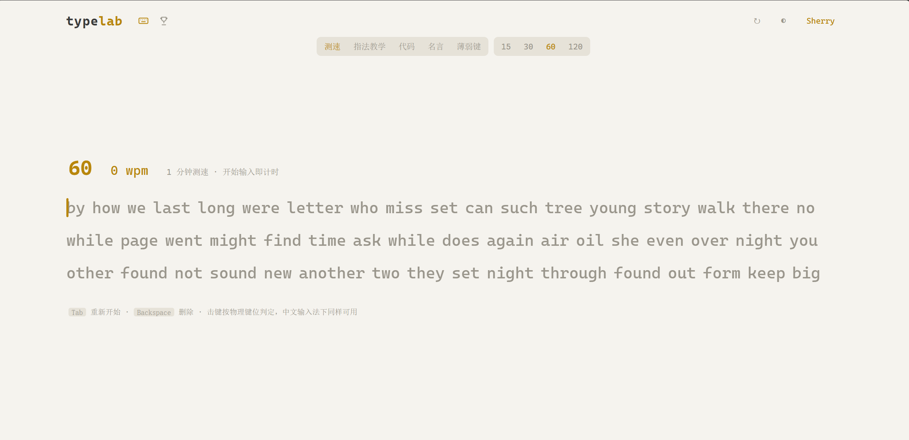

# TypeLab · 打字练习平台

<p align="center">
  
</p>
<p align="center"><em>主界面 · 测速模式（默认 1 分钟倒计时，实时 WPM 与准确率）</em></p>

一个 **纯前端打字引擎 + Spring Boot 后端** 的打字练习平台。前端零依赖、单文件即可运行；后端对标开源项目 [Monkeytype](https://github.com/monkeytypegame/monkeytype)，补齐账号体系、成绩云端存储、全站排行榜与服务端反作弊校验。

---

## 功能特性

### 前端（[index.html](index.html)）

- **五种练习模式**
  - 测速 —— 15 / 30 / 60 / 120 秒限时挑战
  - 指法教学 —— 标准键盘手指分工图 + 基准键练习
  - 代码 —— 扁平化代码片段，`⏎` 处需按 Enter 换行
  - 名言 —— 打完即结束
  - 薄弱键 —— 按历史错误率动态出题的自适应训练
- **物理键位判定**：基于 `KeyboardEvent.code` 而非 `key`，规避中文输入法（IME）下空格等按键事件失效
- **实时指标**：WPM / 原始 WPM / 准确率 / 一致性（标准差），逐字符高亮正确、错误、修正状态
- **结果图表**：Canvas 手绘 WPM 与错误分布曲线
- **主题系统**：暗 / 亮双主题，CSS 变量驱动，`localStorage` 持久化
- **本地优先**：未登录时全部统计数据存本地，登录后自动同步至服务端

### 后端（[typing-server](typing-server)）

- **账号体系**：注册 / 登录 / 刷新 / 登出，JWT 双令牌（Access 15 分钟 + Refresh 7 天），BCrypt 密码加密
- **成绩服务**：成绩上传、个人历史分页、趋势统计、个人最好成绩
- **全站排行榜**：按模式 / 时长 / 语言多维排名，Redis `ZSET` 原子读写
- **服务端反作弊**：7 条拒绝规则 + 3 条待审规则，交叉一致性校验（不重算，只校验）
- **分享短链**：成绩生成短码，可分享结果页
- **运营能力**：名言投稿与审核、举报处理、封禁名单、站内公告、管理员名单、操作日志
- **横切能力**：统一响应体、全局异常处理、JWT 拦截器、AOP 限流、swagger 接口文档

---

## 技术栈

| 层 | 前端 | 后端 |
|---|---|---|
| 语言 | Vanilla JavaScript (ES6+) | Java 17 |
| 框架 | 无（单文件，零构建依赖） | Spring Boot 3.2.5 |
| 持久化 | `localStorage` | MySQL 8.0 + MyBatis-Plus 3.5.5 |
| 缓存 / 排行榜 | — | Spring Data Redis (Lettuce)，`ZSET` |
| 鉴权 | Bearer Token | JJWT 0.12.5（Access + Refresh） |
| 可视化 | Canvas 2D | — |
| 接口文档 | — | springdoc-openapi 2.5.0 |

---

## 目录结构

```
Typing/
├── index.html                 前端单文件应用（界面 + 打字引擎 + API 调用）
├── screenshot.png             界面截图
├── finger-chart.png           指法教学模式的手指分工图
├── 后端项目方案.md             后端设计文档（对标 Monkeytype 的逐条迁移映射）
└── typing-server/             后端 Spring Boot 工程
    ├── pom.xml
    └── src/main/
        ├── java/com/sjt/typing/
        │   ├── common/        统一响应体 R、错误码、全局异常处理、工具类
        │   ├── config/        WebMvc（CORS/拦截器注册）、MyBatis-Plus、OpenAPI
        │   ├── security/      JWT 工具、登录拦截器、管理员拦截器、令牌存储
        │   ├── entity/        数据库实体
        │   ├── mapper/        MyBatis-Plus Mapper + XML
        │   ├── dto/           req 请求体 / vo 响应体
        │   ├── validation/    成绩反作弊校验器
        │   ├── aop/           限流切面 @RateLimit、操作日志切面 @OpLog
        │   ├── service/       业务编排（接口 + impl）
        │   └── controller/    10 个 REST 控制器
        └── resources/
            ├── application.yml
            ├── db/schema.sql  建表脚本（15 张表）
            └── mapper/*.xml
```

---

## 快速开始

### 环境要求

| 依赖 | 版本 |
|---|---|
| JDK | 17+ |
| Maven | 3.8+ |
| MySQL | 8.0+ |
| Redis | 6.0+ |
| 浏览器 | 任意现代浏览器 |

> 前端为单文件零依赖，**不需要 Node.js**。

### 1. 启动前端

直接用浏览器打开 [index.html](index.html)，或用任意静态服务器托管：

```bash
python -m http.server 5500
```

前端默认请求后端 `http://127.0.0.1:8090`（见 [index.html](index.html) 中的 `API_BASE`）。

### 2. 初始化数据库

```bash
mysql -uroot -p -e "CREATE DATABASE typing_db DEFAULT CHARACTER SET utf8mb4 COLLATE utf8mb4_general_ci;"
mysql -uroot -p typing_db < typing-server/src/main/resources/db/schema.sql
```

### 3. 启动后端

```bash
cd typing-server
mvn spring-boot:run
```

服务默认监听 **8090** 端口（8080 常被 Oracle `TNSLSNR` 占用）：

- 接口文档 UI：http://127.0.0.1:8090/swagger-ui/index.html
- OpenAPI JSON：http://127.0.0.1:8090/v3/api-docs

### 4. 打包部署

```bash
cd typing-server
mvn clean package -DskipTests
java -jar target/typing-server-1.0.0.jar
```

### 可配置项

全部支持环境变量覆盖（见 [application.yml](typing-server/src/main/resources/application.yml)）：

| 环境变量 | 默认值 | 说明 |
|---|---|---|
| `SERVER_PORT` | `8090` | 服务端口 |
| `MYSQL_USER` | `root` | 数据库账号 |
| `MYSQL_PASSWORD` | `1234` | 数据库密码 |
| `REDIS_HOST` | `127.0.0.1` | Redis 地址 |
| `REDIS_PORT` | `6379` | Redis 端口 |
| `JWT_SECRET` | 内置占位值 | HS256 密钥，**生产环境务必更换** |
| `SHARE_BASE_URL` | `http://127.0.0.1:8090/?r=` | 分享短链前缀 |

---

## 接口一览

所有接口统一前缀 `/api`，统一响应体 `{ code, message, data }`。

| 模块 | 方法与路径 | 说明 |
|---|---|---|
| 用户 | `POST /api/users/signup` | 注册 |
| | `POST /api/users/login` | 登录 |
| | `POST /api/users/refresh` | 刷新 Access Token |
| | `POST /api/users/logout` | 登出 |
| | `GET /api/users/me` | 当前用户信息 |
| | `GET /api/users/{uid}/profile` | 用户主页 |
| | `GET /api/users/{uid}/results` | 用户成绩列表 |
| 成绩 | `POST /api/results` | 提交成绩（含反作弊校验） |
| | `GET /api/results/my` | 我的成绩分页 |
| | `POST /api/results/{id}/share` | 生成分享短链 |
| | `GET /api/results/{id}/share` | 查询分享内容 |
| 排行榜 | `GET /api/leaderboards` | 排行榜分页 |
| | `GET /api/leaderboards/rank` | 我的排名 |
| 名言 | `GET /api/quotes/random` | 随机名言 |
| | `POST /api/quotes` | 投稿名言（待审） |
| | `POST /api/quotes/{id}/rating` | 名言评分 |
| 分享 | `GET /api/share/{code}` | 按短码查询成绩 |
| 预设 | `GET/POST /api/presets`、`DELETE /api/presets/{id}` | 用户配置预设 |
| 关注 | `POST /api/connections` | 关注用户 |
| 举报 | `POST /api/report` | 提交举报 |
| 站点 | `GET /api/configs`、`GET /api/psas`、`GET /api/public/stats` | 配置 / 公告 / 公开统计（免鉴权） |
| 管理 | `/api/admin/**` | 名言审核、举报处理、封禁、公告、日志、管理员（需管理员身份） |

---

## 反作弊校验规则

成绩由**前端计算、后端校验**。服务端不重算 WPM（没有完整击键流），而是对多个指标做**交叉一致性校验**，伪造者想让所有指标自洽的成本极高。

三级处置：全部通过 `validity=1`；命中待审项 `validity=0`（进人工复核）；命中拒绝项 `validity=-1`（落库留证但不计成绩）。

**拒绝类（7 条）**

| Flag | 含义 |
|---|---|
| `TIME_MISMATCH` | time 模式下 `testDuration` 与时长选项不符 |
| `TIMESTAMP_FUTURE` | 成绩时间戳晚于服务器当前时间 |
| `WPM_TOO_HIGH` | 超过人类极限阈值（默认 350） |
| `RAW_WPM_LT_WPM` | 原始 WPM 小于净 WPM（物理上不可能） |
| `ACC_OUT_OF_RANGE` | 准确率超出 `[0, 100]` |
| `PERFECT_ACC_HAS_ERRORS` | 宣称 100% 准确率却存在错误字符 |
| `CHAR_STATS_WPM_MISMATCH` | 由字符统计反算的 WPM 与提交值偏差过大 |

**待审类（3 条）**

| Flag | 含义 |
|---|---|
| `KEY_SPACING_UNIFORM` | 按键间隔过于均匀，疑似脚本模拟 |
| `AFK_RATIO_HIGH` | 挂机时长占比过高 |
| `CHART_ERR_MISMATCH` | 图表错误分布与字符统计不一致 |

阈值可在 [application.yml](typing-server/src/main/resources/application.yml) 的 `typing.validation` 下调整。

---

## 设计文档

后端的架构取舍、数据库表设计与 Monkeytype 的逐条迁移映射，详见 [后端项目方案.md](后端项目方案.md)。

三个关键设计决策：

1. **成绩由前端计算，后端只做合理性校验** —— 服务端没有完整击键流，重算代价与隐私成本过高，因此着力点是交叉校验而非重放。
2. **一条成绩是一行自包含记录** —— `chartData` / `charStats` 等数组以 MySQL `JSON` 列内嵌，不拆关联表。
3. **Redis 是排行榜的一级存储** —— 查询走 `ZSET`，MySQL 只保留「每人每维度最好成绩」用于冷启动回填。

---

## 备注

- 仓库不包含 IDE 配置（`.idea/`）与构建产物（`target/`），克隆后可直接在 IDEA / Eclipse 中作为 Maven 工程导入。
- `application.yml` 中的数据库密码与 JWT 密钥为**本地开发默认值**，部署到公网前请通过环境变量替换。
